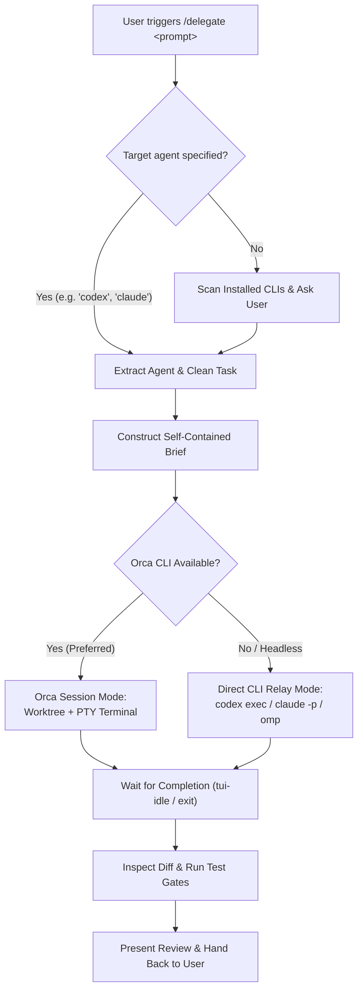

# Universal CLI Agent Delegation (`/delegate`)

This skill provides a unified workflow for an orchestrator agent to delegate implementation tasks to standalone coding agent CLIs—leveraging **Orca CLI sessions** with isolated Git worktrees and interactive PTY terminals, or falling back to **direct headless CLI relays**.

Delegation follows the **Review-First Philosophy**:
1. The orchestrator produces a self-contained, unambiguous brief.
2. The implementer CLI executes in an isolated session or worktree.
3. The orchestrator inspects the resulting diff and test output.
4. The user or orchestrator reviews and commits—**never blind auto-commits**.

> [!NOTE]
> **Scope Boundary**: Task routing intelligence (analyzing which specific model or agent is statistically optimal for a given task complexity) is handled by a companion routing/harness skill. This skill governs the **delegation protocol, agent disambiguation, session dispatching, and diff verification**.

---

## 1. Trigger & Command Syntax

The skill is activated naturally or via the `/delegate` slash command:

```text
/delegate hey codex, i want to create UI for cars display
/delegate claude: refactor database connection pooling
/delegate @omp implement pagination for table view
/delegate fix the memory leak in worker pool
```

### Supported Syntax Patterns
- **Explicit agent & model options**:
  - `/delegate hey <agent>, <task>`
  - `/delegate <agent> --model <model> --reasoning <effort>: <task>`
  - `/delegate @<agent> [model: <model>]: <task>`
  - `/delegate to <agent>: <task>`
- **Unspecified agent**:
  - `/delegate <task>` (triggers **Agent Disambiguation** in Step 1B)
- **Model & Reasoning Control**:
  - `--model <name>` / `-m <name>`: Selects model (e.g. `o3-mini`, `claude-3-7-sonnet`, `deepseek-r1`, `gpt-4.5`, `qwen-2.5-coder-32b`).
  - `--reasoning <effort>` / `-r <effort>`: Specifies reasoning effort level (`low`, `medium`, `high`, `off`).
- **YOLO Mode (Enabled by Default)**:
  - Runs in fully autonomous mode (`--yolo`, `--allow-all`, `--dangerously-skip-permissions`).
  - **Never prompts for interactive tool permission** during the background turn.
  - Can be toggled off with `--safe` or `--no-yolo` if interactive prompts are specifically needed.

---

## 2. Step-by-Step Delegation Workflow



---

### Step 1: Agent Resolution & Disambiguation

#### 1A. Recognized Agents
The dispatcher recognizes standard CLI coding agents and natural language aliases:
- **`codex`**: OpenAI Codex CLI (`codex`)
- **`claude`**: Claude Code (`claude`)
- **`omp`**: Oh My Pi (`omp`)
- **`pi`**: Pi Coding Agent (`pi`)
- **`agy`**: Google Antigravity CLI (`agy`)
- **`opencode`**: OpenCode CLI (`opencode`)
- **`devin`**: Devin CLI (`devin`)
- **`kiro`**: Kiro CLI (`kiro-cli`, `kiro`)
- **`grok` / `xai`**: xAI Grok Build CLI (`grok`, `xai`)
- **`cursor`**: Cursor Agent CLI (`cursor-agent`, `cursor`)
- **`deepseek`**: DeepSeek Harness (`dsh`, `deepseek`)
- **`muse`**: Meta Muse Code (`muse`, `muse-code`)
- **`hermes`**: Hermes Agent (`hermes-agent`, `hermes`)
- **`commandcode`**: Command Code (`cmd`, `commandcode`)
- **`copilot`**: GitHub Copilot CLI (`copilot`, `gh-copilot`)
- **`kimi`**: Moonshot Kimi Code (`kimi`)
- **`zcode`**: Z.AI ZCode (`zcode`)
- **`qwen`**: Alibaba Qwen Code (`qwen`, `qwen-code`)
- **`aider`**: Aider CLI (`aider`)
- **`cline`**: Cline Agent CLI (`cline`)
- **`qoder`**: Qoder CLI (`qoder`)

#### 1B. When Agent is Unspecified: Ask the User
If the prompt does not specify a target agent (e.g., `/delegate create UI for cars display`):
1. Run the discovery helper:
   ```bash
   python3 skills/delegate/scripts/discover_agents.py
   ```
2. Prompt the user using `ask_question` or an interactive selection:
   > "Which AI CLI agent would you like to delegate this task to?"
   > - Options list the installed and detected agents on the machine (e.g. `codex`, `claude`, `omp`, `pi`, `agy`).
3. Remind the user:
   > *"Note: Model evaluation and task-to-model recommendations are scoped under our harness skill. Please select the agent you wish to execute this task."*
4. Once the user replies, proceed with the selected agent.

---

### Step 2: Formulate the Self-Contained Task Brief

Because CLI implementers run in a separate process/session without access to your active conversation history, the brief must be completely self-contained.

Always generate the brief using this structured template:

```markdown
# TASK BRIEF: <Concise Task Title>

## Objective
<1-3 sentences stating exactly what needs to be implemented or fixed.>

## Scope & Target Files
- Primary files to modify:
  - `<relative/path/to/file1>`
  - `<relative/path/to/file2>`
- Reference files to read for conventions:
  - `<relative/path/to/reference>`

## Boundaries & Constraints
- **NO COMMITS**: Do NOT run `git commit`, `git push`, or alter git history.
- Do NOT modify files outside the specified scope.
- Maintain existing codebase formatting, types, and architectural style.

## Acceptance Criteria & Quality Gate
1. Code cleanly builds and passes type check.
2. Verification command passes:
   `<e.g. npm test / pytest / cargo test / make verify>`
3. Summary of all changes returned upon completion.
```

---

### Step 3: Dispatch via Orca CLI Session (Preferred)

When running inside or with Orca, use Orca's native session and worktree commands. This guarantees that background agents work on isolated git branches and cannot collide with the active workspace.

#### 1. Resolve the Orca Binary
Follow the session resolution rules:
1. If `$ORCA_CLI_COMMAND` is set, use its value.
2. If inside a dev checkout with `$ORCA_DEV_REPO_ROOT`, use `orca-dev`.
3. On Linux outside an Orca terminal, use `orca-ide` (avoids GNOME screen reader `/usr/bin/orca`).
4. Otherwise, use `orca`.

*(Referenced as `ORCA` below)*.

#### 2. Create an Isolated Worktree (Optional but Recommended for Large Tasks)
```bash
ORCA worktree create --repo id:<repoId> --name delegate-<agent>-<task_slug> --json
```

#### 3. Create Terminal Session & Spawn Agent
```bash
# Create an agent terminal session in the worktree
ORCA terminal create --worktree active --command "<agent>" --json
```

#### 4. Send the Brief
```bash
ORCA terminal send --worktree active --text "$BRIEF_CONTENT" --enter --json
```

#### 5. Wait for Completion
```bash
# Wait for the agent TUI to return to idle
ORCA terminal wait --for tui-idle --timeout-ms 300000 --json
```

#### 6. Read Output Buffer
```bash
ORCA terminal read --worktree active --lines 200 --json
```

> For full Orca command reference, see [Orca CLI Reference](./references/orca-session.md) and the bundled [`orca-cli` skill](../orca-cli/SKILL.md).

---

### Step 4: Fallback Dispatch via Direct CLI Relay

If Orca is not active or headless execution is requested, dispatch directly through the bundled helper script:

```bash
python3 skills/delegate/scripts/delegate.py \
  --agent codex \
  --brief "brief.md" \
  --verify "npm test" \
  --json
```

The relay runs the implementer command (e.g. `codex exec`, `claude -p`, `omp`, `pi -p`) with timeouts and strict execution boundaries, capturing results in the `delegate-relay.result.v1` schema:

```json
{
  "schema": "delegate-relay.result.v1",
  "agent": "codex",
  "status": "success",
  "exitCode": 0,
  "executionTimeMs": 34200,
  "touchedFiles": [
    "src/components/CarCard.tsx",
    "src/components/CarCard.test.tsx"
  ],
  "diffStat": "2 files changed, 84 insertions(+), 3 deletions(-)",
  "verification": {
    "command": "npm test",
    "passed": true
  },
  "summary": "Created CarCard component with props for brand, model, price, and specs, along with comprehensive unit tests."
}
```

---

### Step 5: Review Gate & Handback

1. **Check Status & Diff**:
   ```bash
   git status --short
   git diff --stat
   ```
2. **Execute Project Verification Gate**:
   Run the project's canonical verify command (e.g., `make verify`, `pytest`, `npm test`).
3. **Report to User**:
   - Agent used and execution status.
   - List of files modified/created.
   - Diff statistics and key implementation notes.
   - Pass/fail state of the verification command.
   - **Hand off to user**: Prompt the user to review the diff before committing.
   > *"The changes have been implemented by `<agent>` and verified against your test suite. Would you like to review the full diff or proceed with committing these changes?"*

---

## 3. Helper Scripts

- [delegate.py](./scripts/delegate.py): Universal dispatcher supporting both Orca sessions and headless relays (with model selection, reasoning control, and default YOLO mode).
- [discover_agents.py](./scripts/discover_agents.py): Scans environment and PATH for installed coding agent CLIs.
